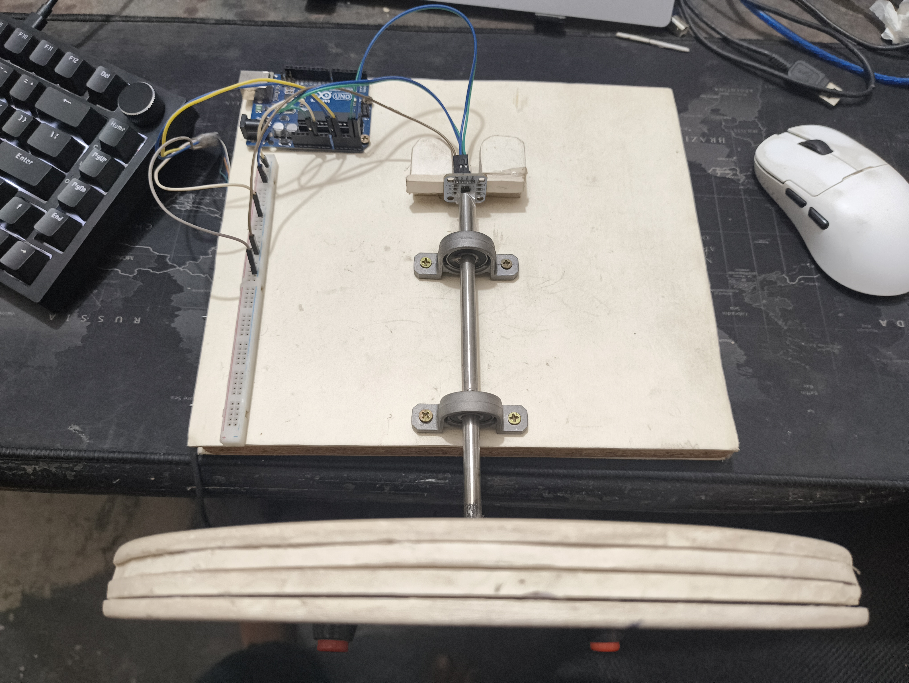
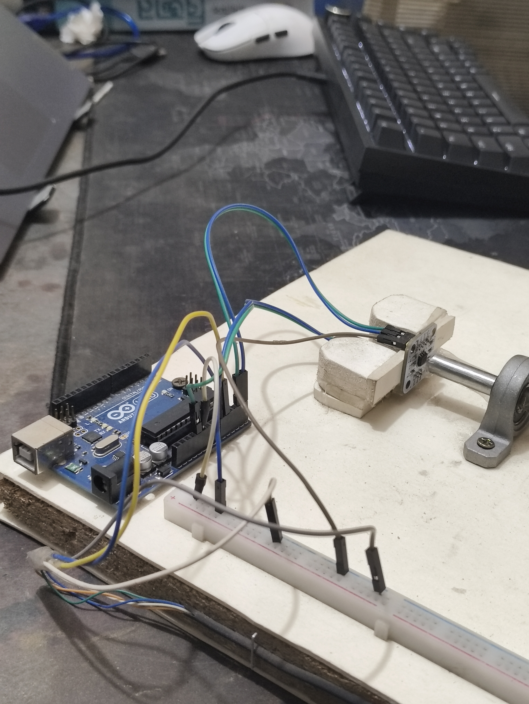
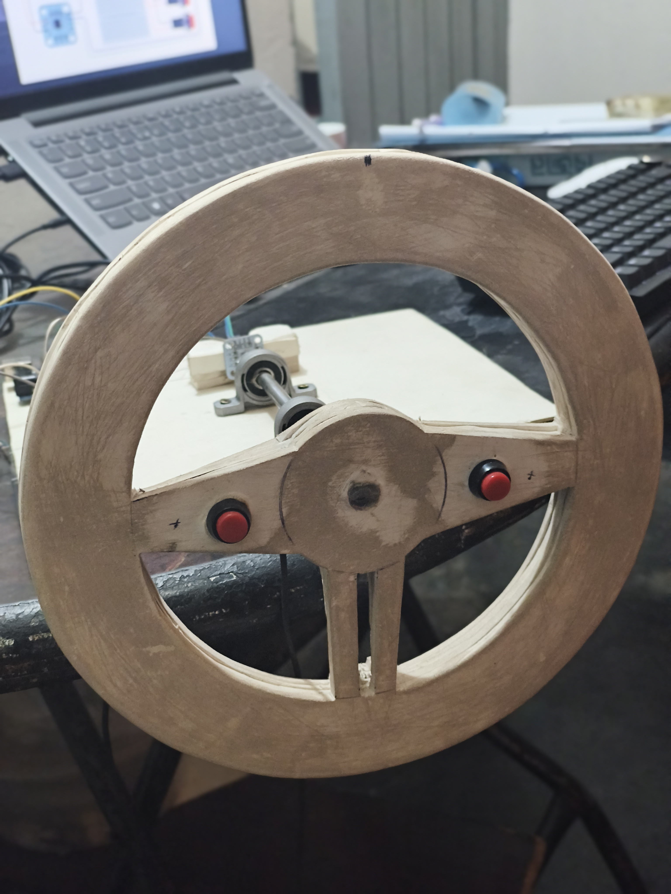
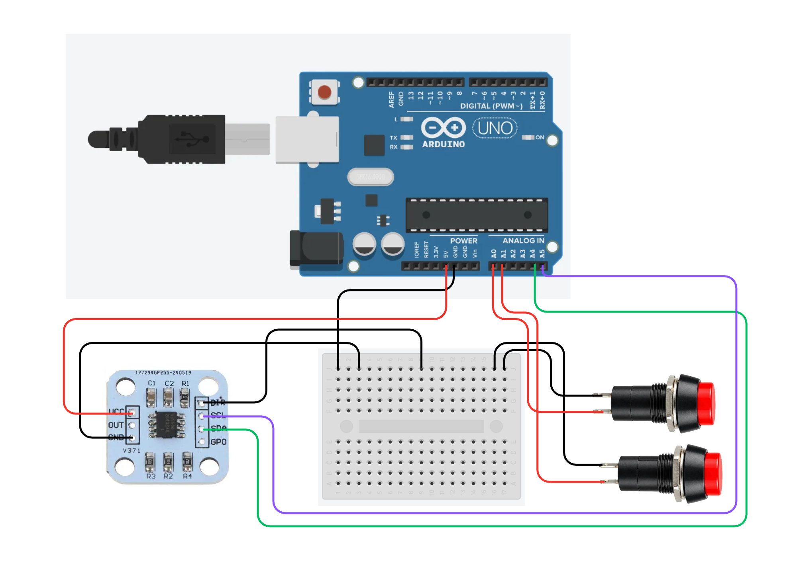

# DIY Steering Wheel Setup Guide

This guide explains how to build and run the DIY steering wheel with an Arduino Uno R3, an AS5600 magnetic angle sensor, Python, and vJoy on Windows. Follow the steps in order. Ask an adult to help with drilling, cutting, soldering, or any work that could hurt your hands.

## 1. Components

- Arduino Uno R3
- AS5600 Magnetic Encoder Angle Sensor Module
- A magnet compatible with the AS5600 sensor, if one is not included with the module
- Zinc Alloy KP08/P08 Pillow Block Mounted Ball Bearing, 8 mm bore diameter
- 8 mm smooth stainless steel rod (linear shaft)
- Four 5 mm PVC sheets for the steering wheel, or 3D-printed steering parts
- Jumper wires
- Screws and nuts
- A piece of wood for the base
- Glue
- Two On-Off push buttons (momentary switches): one for throttle and one for brake
- A USB data cable for the Arduino
- A Windows PC

The two switches work like keyboard keys: pressed or released. They do not provide gradual throttle or brake control.

## 2. Assemble the steering wheel

1. Use the wood as the base.
2. Fasten the KP08/P08 bearing block to the base with screws and nuts.
3. Pass the 8 mm smooth rod through the bearing.
4. Make the steering wheel from the four PVC sheets, or use 3D-printed parts. Secure the wheel to the rod.
5. Mount the AS5600 sensor so the magnet attached to the rotating part passes over the sensor. Follow the sensor module's alignment and spacing instructions.
6. Secure the parts so the wheel and shaft can turn freely without loose wires catching on them.

The photos below show the prototype. Exact wheel dimensions and magnet-to-sensor spacing are not specified, so measure those if you want someone else to reproduce the build exactly.

## Photos of this build

<table>
  <tr>
    <td></td>
    <td></td>
    <td></td>
  </tr>
</table>

## 3. Circuit



In the diagram, the top button connects to `A0` (throttle) and the bottom button connects to `A1` (brake). Their other terminals share GND. The red wire from Arduino `5V` powers the sensor; the red wires from `A0` and `A1` are button signals.

The Arduino sketch uses the following pins:

| Part | Arduino Uno R3 connection |
|---|---|
| AS5600 SDA | SDA (A4) |
| AS5600 SCL | SCL (A5) |
| AS5600 VCC | Arduino Uno R3 5V/VCC |
| AS5600 GND | GND |
| AS5600 DIR | GND |
| Throttle button | Between A0 and GND |
| Brake button | Between A1 and GND |

The sensor module's `OUT` and `GPO` pins are not used. Disconnect the Arduino from USB before wiring. In this build, AS5600 `VCC` connects to the Arduino Uno R3 `5V/VCC` pin. If you use a different AS5600 breakout board, check its power-input rating first. The sketch uses the Arduino's internal pull-up resistors, so each momentary button connects its input pin to GND when pressed.

## 4. Upload the Arduino code

1. Install [Arduino IDE 2](https://docs.arduino.cc/software/ide-v2/tutorials/getting-started/ide-v2-downloading-and-installing/).
2. Open `Codes/SteeringWheel.ino` from this repository.
3. Connect the Arduino Uno R3 to the PC with the USB data cable.
4. In Arduino IDE, select **Arduino Uno** and the COM port for your board.
5. Click **Upload** and wait for the upload to finish. See Arduino's [official upload instructions](https://docs.arduino.cc/software/ide-v2/tutorials/getting-started/ide-v2-uploading-a-sketch/).
6. When the Arduino restarts, keep the wheel straight and centered. The sketch treats the wheel's position at startup as the center.

To check the Arduino output, open the IDE's **Serial Monitor** and set its speed to **9600 baud**. Turn the wheel and press each button. The Arduino sends three values in this order: `steering_degrees,throttle,brake`. For example, `+12,1,0` means the wheel is 12 degrees to one side, the throttle button is pressed, and the brake button is released. Close Serial Monitor before running the Python program.

## 5. Install and check vJoy

1. Download and install vJoy from the [vJoy SourceForge page](https://sourceforge.net/projects/vjoystick/).
2. Open **Configure vJoy** from the Windows Start menu.
3. Select **Device 1** and enable it.
4. Enable the **X, Y, and Z axes**, plus at least **4 buttons**, then apply the settings.
5. Check that Windows can see the virtual controller:
   - Press `Win + R`.
   - Type `joy.cpl` and press Enter.
   - Find the vJoy device in the list, open **Properties**, and check that it is present.

The Python program sends steering on X, throttle on Y, and brake on Z. Optional vJoy buttons 1–4 are mapped to the keyboard keys `5`, `Up`, `Down`, and `Space`.

## 6. Install Python and the required packages

If Python is not installed, download it from [Python.org](https://www.python.org/downloads/windows/) and install it.

Open Windows Terminal or Command Prompt and install the two packages:

```powershell
pip install pyserial
pip install pyvjoy
```

If Windows does not recognize `pip`, use these commands instead:

```powershell
py -m pip install pyserial
py -m pip install pyvjoy
```

## 7. Find the Arduino COM port and run the Python program

1. Download `Codes/python_code.py` from this repository.
2. Connect the Arduino to the PC and open a terminal in the `Codes` folder.
3. List the available serial ports:

   ```powershell
   py python_code.py --list-ports
   ```

4. Find the Arduino's port in the list. It may be `COM3`, `COM4`, or another number.
5. Close Arduino Serial Monitor and any other program using the Arduino's COM port.
6. Keep the wheel straight and centered, then run the program. Replace `COM3` with the port shown on your PC:

   ```powershell
   py python_code.py --port COM3
   ```

7. The terminal should say `Controller started` and show steering, throttle, and brake values as you turn the wheel and press the buttons.
8. Press `Ctrl + C` in the terminal to stop the program.

## 8. Set up the controls in your game

Open the game's controller or controls settings and assign the vJoy **X axis** to steering, **Y axis** to throttle/accelerator, and **Z axis** to brake. Game menus use different names, so choose the matching axis shown by the game. If steering moves in the wrong direction, turn on the game's **Invert Axis** option for steering.

## Games tested

I tested this steering wheel with Euro Truck Simulator 2, [Slow Roads](https://slowroads.io/), and Assetto Corsa. It works great in all three after setup. Assetto Corsa needs a few additional changes to its game files before it is ready to use.

## Quick troubleshooting

| What you see | What to check |
|---|---|
| No Arduino COM port appears | Reconnect the Arduino, try a USB data cable, and check Windows Device Manager. |
| Python cannot open the COM port | Close Serial Monitor and any other app using that port. Check that you typed the right COM number. |
| vJoy device is not listed in `joy.cpl` | Reopen Configure vJoy and make sure Device 1 is enabled. |
| Python says it cannot open vJoy Device 1 | Enable Device 1 and its X/Y/Z axes and at least 4 buttons in Configure vJoy. |
| Arduino sends no values | Check the AS5600 power, GND, SDA/SCL wiring, and magnet alignment. |
| Steering starts off-center | Restart the Arduino with the wheel straight and centered. |

## Project files

- `Codes/SteeringWheel.ino` — Arduino IDE sketch
- `Codes/python_code.py` — Python program for the controller

